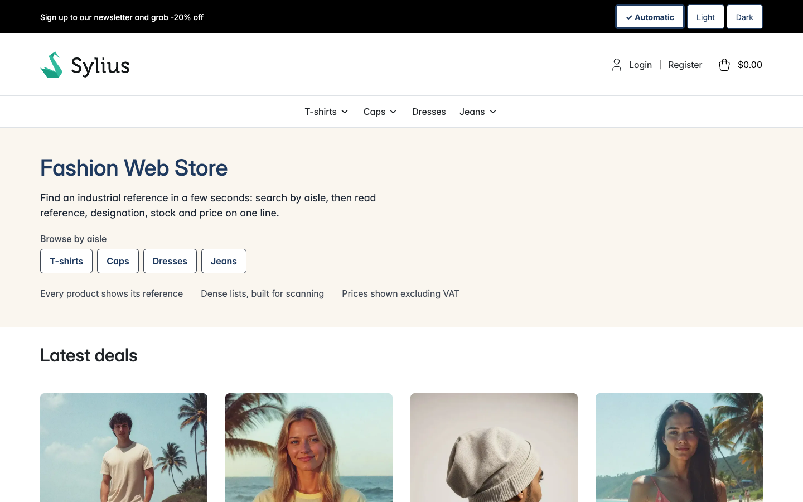
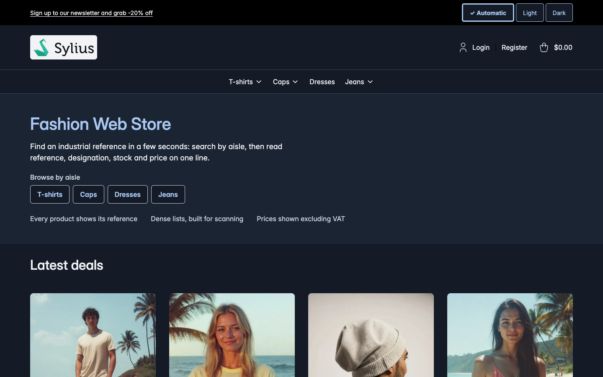
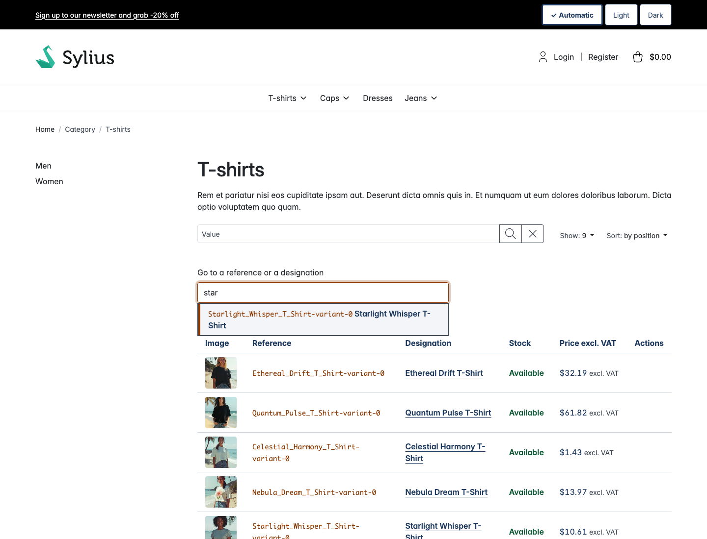
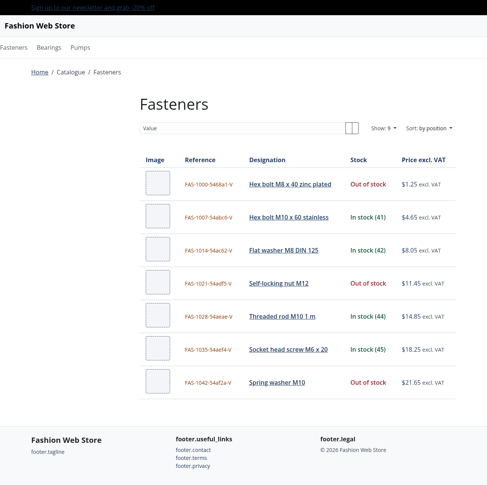
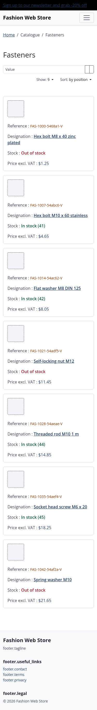
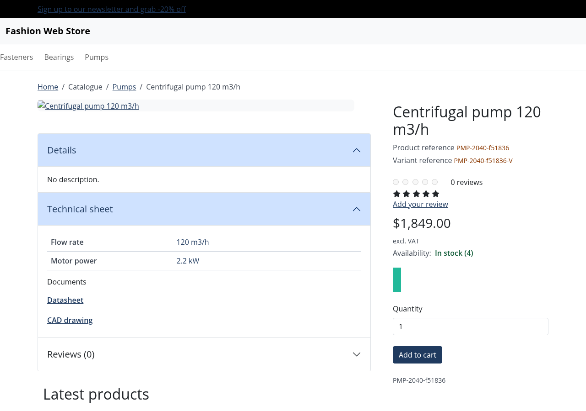
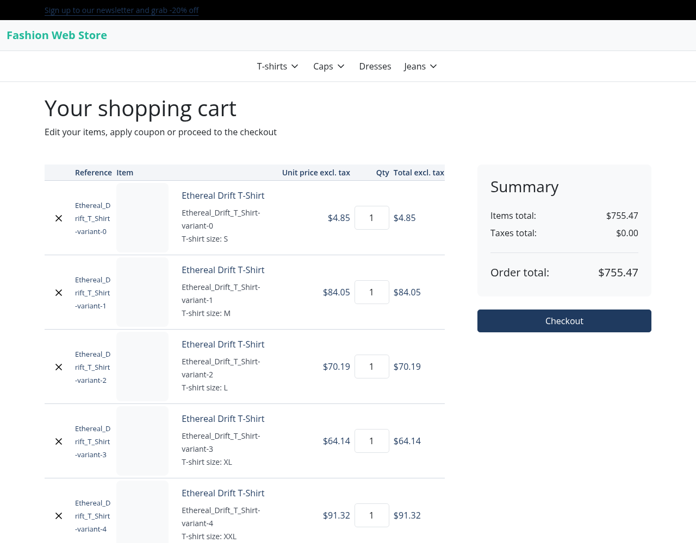
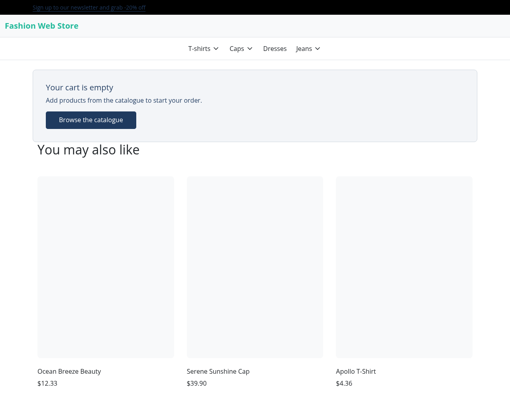
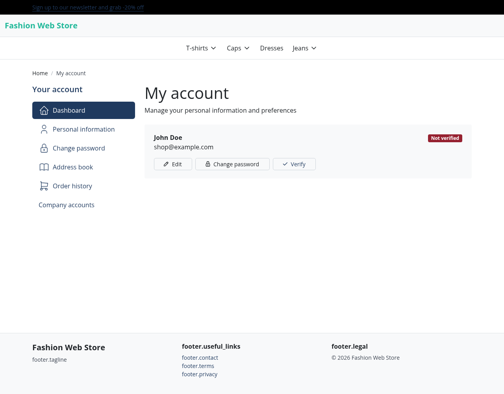
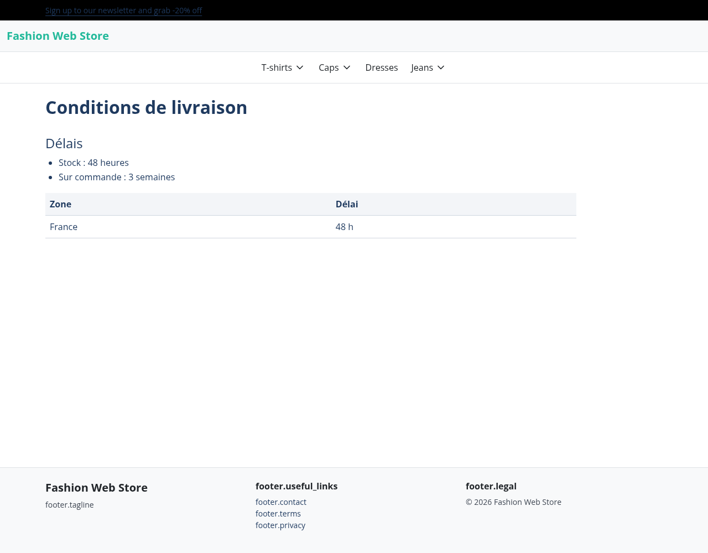

# Sylius Industry & Trade Theme

> English: [README.md](README.md) <!-- vitrine:lang -->

Thème B2B pour [Sylius](https://sylius.com) 2 optimisé pour l'industrie et le négoce : haute densité d'information, contrastes AAA.

## Caractéristiques

- **Jetons de design** : palette de couleurs avec contrastes WCAG AAA (≥ 7:1), surchargeables via propriétés CSS personnalisées
- **Mode sombre optionnel** : jeu de jetons sombre, toutes les paires texte/fond à 7:1 (AAA, vérifié en CI), commutateur clair/sombre mémorisé d'une visite à l'autre
- **Composants communs** : en-tête, pied de page, boutons, tableaux, formulaires, messages
- **Panier, compte et pages de contenu** : panier dense (référence, quantité modifiable, prix HT), navigation du compte au style du thème (entrées des plugins seulement si le plugin est installé), gabarit de page de contenu `@TmonierSyliusIndustryTradeTheme/content/page.html.twig`
- **Compatibilité** : Sylius 2.2 et 2.3, PHP 8.3+
- **Assets** : Webpack Encore

## Prérequis

- PHP 8.3 ou supérieur
- Sylius 2.2.9 ou 2.3+
- Sylius Theme Bundle ^2.4

## Installation

<!-- blank-project: step=require -->
```bash
composer require tmonier/sylius-industry-trade-theme
```

Copier la configuration dans votre application :

<!-- blank-project: step=copy-config -->
```bash
cp vendor/tmonier/sylius-industry-trade-theme/config/packages/tmonier_sylius_industry_trade_theme.yaml config/packages/
cp -r vendor/tmonier/sylius-industry-trade-theme/config/twig_hooks config/
```

Ce que fait la configuration, et ce qu'elle ne fait jamais :

- Elle déclare le namespace Twig `@TmonierSyliusIndustryTradeTheme` (`twig.paths`), résolu sur tous les canaux, pour les gabarits que le thème ajoute : la colonne « Référence » du panier, les entrées de navigation du compte et le gabarit de page de contenu.
- Elle ajoute deux hookables, `industry_reference`, à l'en-tête et au corps du tableau du panier (priorité 350). Ils n'affichent rien tant que le thème n'est pas actif sur le canal courant.
- Elle ne REMPLACE aucun hookable de Sylius ni de votre application. Les pages du thème (en-tête, pied de page, messages flash, panier, compte, liste produits, champ de recherche) sont des surcharges de gabarits sous `templates/bundles/SyliusShopBundle/`, que Sylius n'applique qu'aux canaux qui utilisent le thème. Les hookables que vous ajoutez à `sylius_shop.base.header.content`, `sylius_shop.base.footer.content` ou à la liste produits continuent de s'afficher, et vos propres réglages sur les hookables `items`, `coupon`, `summary`, `form` et `account` du panier et du compte (gabarit, props, priorité) restent les vôtres, sur un canal avec ou sans le thème.
- Elle ajoute encore un hookable, `industry_color_mode` (`config/twig_hooks/color_mode.yaml`), à la barre du haut de la boutique (`sylius_shop.base.header.top_bar`, priorité -100) : le commutateur clair/sombre. Il n'affiche rien tant que le thème n'est pas actif sur le canal courant. Ne copiez pas ce fichier si vous ne voulez pas du commutateur : le thème suit alors le seul réglage du système.
- Le lien vers la saisie rapide d'un panier vide n'apparaît que si le plugin quick-order est installé.

### Installation des styles et des assets

Le paquet livre les sources SCSS, pas d'assets compilés. Importez-les dans l'entrée Encore de votre application, **après** les styles du shop Sylius (chargeur Sass activé, comme dans une application Sylius standard) :

<!-- blank-project: step=styles file=assets/shop/entrypoint.scss write=append -->
```scss
// assets/shop/entrypoint.scss (ou la feuille importée par votre entrée shop)
@use '../../vendor/tmonier/sylius-industry-trade-theme/assets/styles/theme';
```

Si votre entrée shop n'importe encore aucune feuille de style (projet Sylius-Standard neuf), importez-y ce fichier :

<!-- blank-project: step=styles-entry file=assets/shop/entrypoint.js write=append -->
```js
import './entrypoint.scss';
```

puis compilez comme d'habitude :

<!-- blank-project: step=build -->
```bash
npm run build
```

Toutes les règles du thème sont limitées à `[data-theme="industry-trade"]`, attribut que le layout du thème pose sur le `<body>` : sur un canal sans le thème, ou ailleurs dans votre application, aucun jeton ni aucun composant ne change.

### Activation du thème

Sylius doit trouver le thème : sa source `filesystem` parcourt les dossiers de `sylius_theme.sources.filesystem.directories` (fichiers `composer.json`, sur `scan_depth` niveaux), par exemple

<!-- blank-project: step=theme-source file=config/packages/sylius_theme.yaml write=replace -->
```yaml
sylius_theme:
    sources:
        filesystem:
            scan_depth: 1
            directories:
                - '%kernel.project_dir%/themes'
                - '%kernel.project_dir%/vendor/tmonier'
```

Définissez ensuite le `theme_name` d'un canal Sylius à `tmonier/sylius-industry-trade-theme`.

La CI exécute cette procédure telle quelle dans un projet Sylius-Standard neuf (Sylius 2.2 et 2.3) : les blocs de code marqués `blank-project` ci-dessus sont lancés par `bin/blank-project-steps`, puis le job vérifie un canal avec le thème et un canal sans. Modifiez une commande ici, le job lance la nouvelle.

## Usage

### Personnalisation des jetons de design

Le thème définit ses propriétés CSS personnalisées sur `[data-theme="industry-trade"]` (couleurs, espacements, polices), pas sur `:root` : elles ne peuvent pas entrer en collision avec les variables de votre application. Pour les surcharger, utilisez le même sélecteur, chargé après la feuille de style du thème :

```css
[data-theme="industry-trade"] {
    --bs-primary: #your-navy;
    --industry-accent: #your-accent;
    --bs-link-color: #your-link-color;
    --bs-link-hover-color: #your-hover-color;
}
```

Voir `assets/styles/theme.scss` pour la liste complète des propriétés personnalisées disponibles.

### Mode sombre (optionnel)

Le thème livre un jeu de jetons sombre sous `[data-theme="industry-trade"]`. Il n'y a pas de mode sombre par défaut :

- **Réglage du système** : tant que le visiteur n'a rien choisi, `prefers-color-scheme: dark` applique les jetons sombres ; un système clair reste clair.
- **Sélecteur** : trois boutons dans la barre du haut (« Automatique », « Clair », « Sombre » ; chacun est nommé, `aria-pressed` annonce l'actif, une coche le marque sans dépendre de la couleur, accessible au clavier, cibles de 44 px). « Clair » ou « Sombre » pose `data-industry-mode` sur `<html>` et mémorise le choix dans `localStorage` (clé `industry-trade:color-mode`) ; un choix l'emporte sur le réglage du système. « Automatique » retire cette clé et l'attribut : la page suit de nouveau `prefers-color-scheme`, y compris quand le système change pendant la visite. Le script émet un événement `industry-trade:color-mode-change` sur `document` (`detail.choice`, `detail.mode`) si votre propre code (graphiques, cartes) doit suivre.
- **Sans scintillement** : un petit script en ligne dans le `<head>`, exécuté avant les feuilles de style, applique le choix mémorisé avant le premier affichage. Le sélecteur reste masqué tant que ce script n'a pas tourné (sans JavaScript, il ne ferait rien).
- **Stockage indisponible** (navigation bloquée ou privée) : le mode s'applique à la page courante, rien n'est mémorisé, aucune erreur JavaScript.
- **CSP** (`script-src` strict, sans `'unsafe-inline'`) : le script est en ligne (`<script data-industry-color-mode>`). Deux façons de l'autoriser. (1) Nonce : si votre application expose une variable Twig `industry_trade_script_nonce` (par exemple une globale Twig ou une extension `GlobalsInterface` qui renvoie le nonce de script de votre générateur, comme celui de NelmioSecurityBundle), le script porte `nonce="..."` ; le thème ne dépend d'aucun bundle. (2) Empreinte : ajoutez `'sha256-Ter0gpyamaHCdpF/mPdb6ndLUHpL2AijAKVWPWZGOBg='` à `script-src`. Cette empreinte est le SHA-256 du contenu exact du script ; `ColorModeScriptCspTest` échoue en CI quand le script change sans que cette valeur (et celle de `README.md`) soit mise à jour. Si le script est bloqué, le sélecteur reste masqué (il l'est tant que le script n'a pas tourné) et la page suit le réglage du système.
- **Contraste** : les paires sombres sont les jetons `$industry-dark-*` de `assets/styles/_variables.scss` ; `tests/Unit/Theme/ColorContrastTest.php` les lit et échoue en CI, en nommant la paire, quand l'une passe sous 7:1 (3:1 pour les limites de contrôles).
- **Surcharges** : vos surcharges `[data-theme="industry-trade"]` valent en mode clair ; pour changer une couleur en mode sombre, utilisez `[data-industry-mode="dark"] [data-theme="industry-trade"] { ... }` (et la même règle dans `@media (prefers-color-scheme: dark)` sur `html:not([data-industry-mode])` pour qu'elle suive aussi le système).
- **Logo** : en mode sombre, le thème place un fond clair arrondi derrière le logo de l'en-tête (`header a[aria-label*='logo' i]`), donc un logo à texte sombre, comme celui de Sylius par défaut, reste lisible ; votre logo n'est pas modifié. Si vous avez un logo prévu pour le sombre, annulez le fond avec `[data-industry-mode="dark"] [data-theme="industry-trade"] header a[aria-label*='logo' i] { background: none; padding: 0; }`.

| Clair | Sombre |
|---|---|
|  |  |

### Saisie au clavier sur la liste produits

Sur la liste dense (pages de rayon et de résultats de recherche), un champ « Aller à une référence ou une désignation » permet d'atteindre une ligne sans souris :

- **Champ** : combobox ARIA (`role="combobox"`, `aria-controls`, `aria-activedescendant`). La saisie filtre les références et désignations **des lignes de la page** (aucune requête réseau : le cœur n'a pas de point d'accès qui cherche par référence, la recherche de sa liste ne porte que sur le nom). La première correspondance est mise en évidence, <kbd>↓</kbd>/<kbd>↑</kbd> parcourent les correspondances, <kbd>Entrée</kbd> place le focus sur la ligne, <kbd>Échap</kbd> ferme la liste puis vide le champ.
- **Annonces** : une région live (`role="status"`) dit « N références trouvées » ou « Aucune référence trouvée ».
- **Grille** : <kbd>←</kbd>/<kbd>→</kbd> passent d'une cellule focalisable à l'autre d'une ligne (lien, boutons), <kbd>↑</kbd>/<kbd>↓</kbd> vers la même cellule de la ligne voisine, <kbd>Échap</kbd> revient au champ ; l'indicateur de focus fait 3 px. Les champs de quantité gardent leurs propres flèches.
- **Sans JavaScript**, le champ reste masqué (`hidden`) et la liste se lit comme avant. **CSP** : le script est en ligne (`<script data-industry-quick-find-script>`) ; il porte le nonce de l'application quand la variable Twig `industry_trade_script_nonce` est définie (comme le script du mode d'affichage) ; sinon, ajoutez 'sha256-UtJO2cK4ZiY0HTR39tItR/U8YODUkpxMoJ08YnSUzbQ=' à `script-src` (SHA-256 du contenu exact du script ; `QuickFindScriptCspTest` échoue en CI quand le script change sans que cette valeur, et celle de `README.md`, soit mise à jour). Sous une CSP qui le bloque, le champ reste masqué.
- Le plugin quick-order garde sa page et ses champs ; le thème n'y touche pas.



Le comportement au clavier est couvert par `tests/Unit/Theme/QuickFindScriptTest.php` (script exécuté sous Node) et `tests/Functional/QuickFindTest.php`.

### Surcharge des composants

Sur un canal qui utilise le thème, un gabarit du thème **l'emporte sur** le même gabarit dans `templates/bundles/` de votre application. L'ordre de recherche, pour un canal themé, est :

1. le thème actif, puis ses thèmes parents (`parents` dans la configuration du thème) : `vendor/tmonier/sylius-industry-trade-theme/templates/bundles/<Bundle>/...` ;
2. votre application : `templates/bundles/<Bundle>/...` ;
3. le bundle Sylius : `vendor/sylius/sylius/src/Sylius/Bundle/ShopBundle/templates/...`.

(C'est ainsi que `sylius/theme-bundle` résout un gabarit : `NamespacedTemplateLocator` cherche d'abord dans le thème, `ThemeHierarchyProvider` ajoute les parents.) Un canal sans le thème ne voit que les niveaux 2 et 3.

Pour modifier un gabarit que le thème surcharge, ne le copiez pas dans `templates/bundles/` : il serait ignoré sur les canaux themés. Créez votre propre thème qui déclare celui-ci comme parent, placez-y votre gabarit, et affectez votre thème au canal :

```json
{
    "name": "acme/shop-theme",
    "extra": {
        "sylius-theme": {
            "title": "Acme",
            "parents": ["tmonier/sylius-industry-trade-theme"]
        }
    }
}
```

avec `templates/bundles/SyliusShopBundle/...` à côté de ce `composer.json` (dans le dossier `themes/` de l'application par défaut). Les deux hookables de la colonne « Référence » comparent le thème du canal à `industry_theme_name` : avec un thème enfant, redéfinissez ce global Twig au nom de votre thème (`twig.globals.industry_theme_name`).

Les hookables et leurs props restent le moyen de changer ce que le thème ne surcharge pas : ajoutez-les ou configurez-les dans votre propre fichier `sylius_twig_hooks`.

### Revue de la dérive des gabarits

Chaque gabarit surchargé par le thème sous `templates/bundles/<Bundle>/**` est dérivé d'un gabarit Sylius. Le test unitaire `tests/Unit/TemplateDrift/ThemeTemplateDriftTest.php` compare l'empreinte de chaque gabarit d'origine (sha256 normalisée, par version mineure de Sylius) à `tests/TemplateDrift/fingerprints.json`, enregistré à la dernière revue. Il tourne dans la testsuite `unit` et dans une exécution planifiée hebdomadaire (lundi). Les surcharges sont découvertes automatiquement.

Quand il échoue, le message nomme le gabarit :

- **gabarit d'origine modifié** : lire le diff amont entre la version de Sylius précédemment revue et la nouvelle, adapter la surcharge, puis lancer `php bin/template-fingerprints --update` ;
- **gabarit supprimé en amont** : adapter ou retirer la surcharge (le script refuse d'écrire tant qu'un original manque) ;
- **surcharge non enregistrée** : lancer `php bin/template-fingerprints --update` après revue.

Le script réécrit les empreintes de la version mineure de Sylius installée dans `vendor/`. Pour enregistrer aussi l'autre version mineure, l'installer (`composer require sylius/sylius:~2.2.0 --no-update && composer update`), relancer le script, puis restaurer votre contrainte. `php bin/template-fingerprints --check` signale seulement la dérive.

## Captures

Pages du catalogue (rendues avec Bootstrap et la feuille de style du thème ; l'en-tête et le pied de page sont montrés sans la feuille de style complète de Sylius).

| Page | Capture |
|------|---------|
| Accueil (titre, rayons du taxon de menu du canal) |  |
| Liste dense (référence, désignation, stock, prix HT) |  |
| Liste sous 768 px (cartes, sans défilement horizontal) |  |
| Fiche produit (références, fiche technique, documents, disponibilité) |  |

## Pages du catalogue

- **Accueil** : titre, accroche et un lien par enfant du taxon de menu du canal (masqué si le canal n'en a pas).
- **Liste des produits** : une ligne par produit avec référence, désignation, stock, prix HT et une cellule d'actions. La cellule prix rend le hook du cœur `sylius_shop.shared.product.card.prices` et la cellule d'actions les hookables de `sylius_shop.shared.product.card` (favoris, panier, devis... ajoutés par votre application ou vos plugins) : un prix masqué par votre application reste masqué. Le stock exact est toujours affiché ; sous 768 px chaque ligne devient une carte. Un produit sans image affiche un visuel de substitution.
- **Fiche produit** : références produit et variante, disponibilité, fiche technique (attributs du produit) et liste de documents pour les attributs dont la valeur texte est un lien vers un fichier pdf, dwg, step, zip, doc ou xls. Les blocs des plugins (par exemple les prix dégressifs) restent ceux des plugins et sont absents si le plugin n'est pas installé.
- Textes dans le domaine de traduction `industry_trade` (`translations/`, anglais et français).
- Réalisé par surcharge de gabarits (`templates/bundles/SyliusShopBundle/`), qui ne s'appliquent qu'aux canaux utilisant le thème et ne touchent pas à la configuration des hooks de votre application. Les seuls ajouts globaux sont les deux hookables « Référence », gardés dans leurs gabarits.

| Panier (12 lignes) | Panier vide |
|---|---|
|  |  |

| Navigation du compte | Page de contenu |
|---|---|
|  |  |

<!-- vitrine:demo-b2b:start -->
## Démo B2B

Ce plugin est utilisé dans la [démo B2B Sylius](https://github.com/thibmonier/sylius-b2b-demo) : une boutique Sylius 2.3 avec des données d'exemple fictives, où les plugins B2B fonctionnent ensemble. Le code source, l'installation et les fixtures de la démo sont dans ce dépôt.

- Démo en ligne : [sylius-b2b.thibaut-monier.fr](https://sylius-b2b.thibaut-monier.fr)
- Auteur : [Thibaut Monier](https://www.linkedin.com/in/thibautmonier/)

La démo est un exemple, pas une configuration de production.
<!-- vitrine:demo-b2b:end -->

## Licence

MIT
