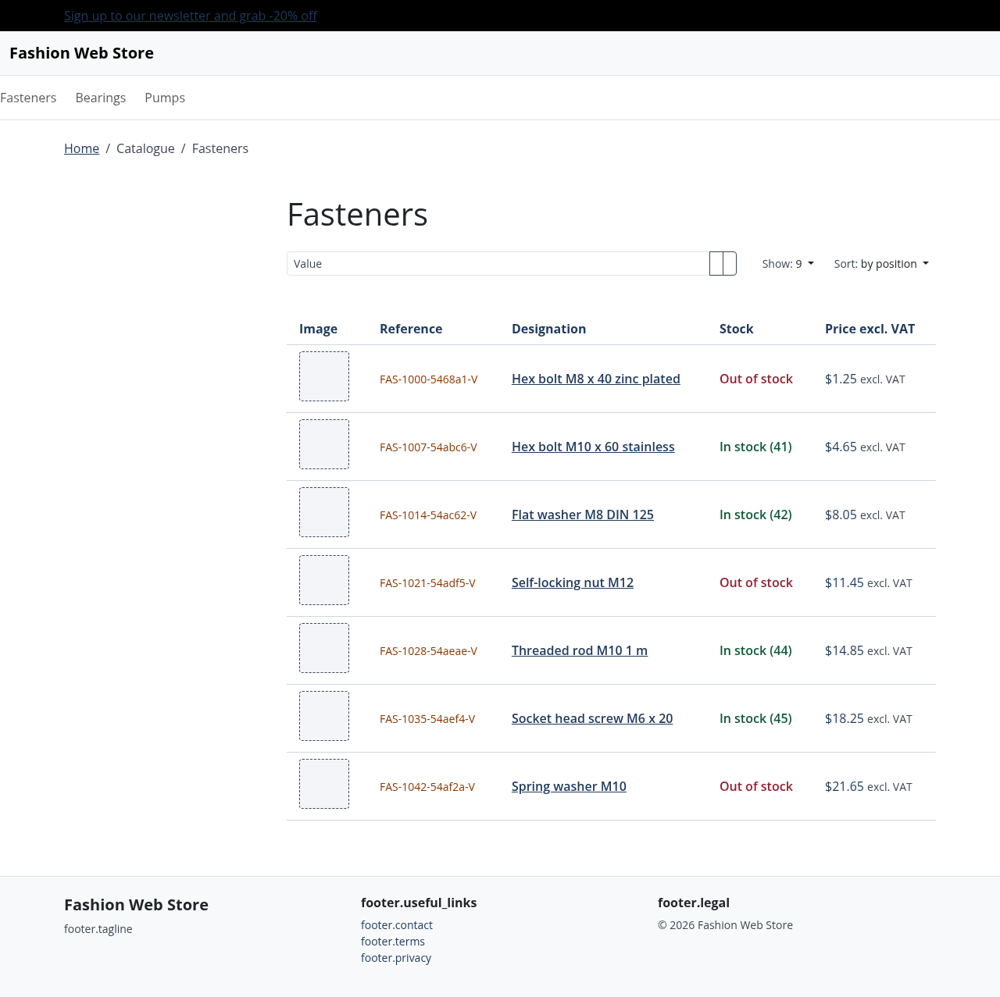
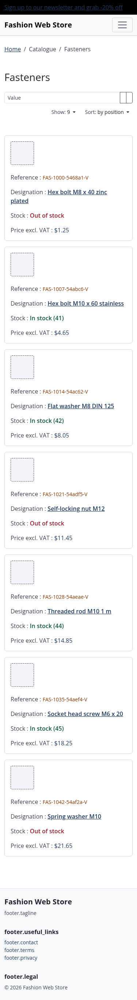
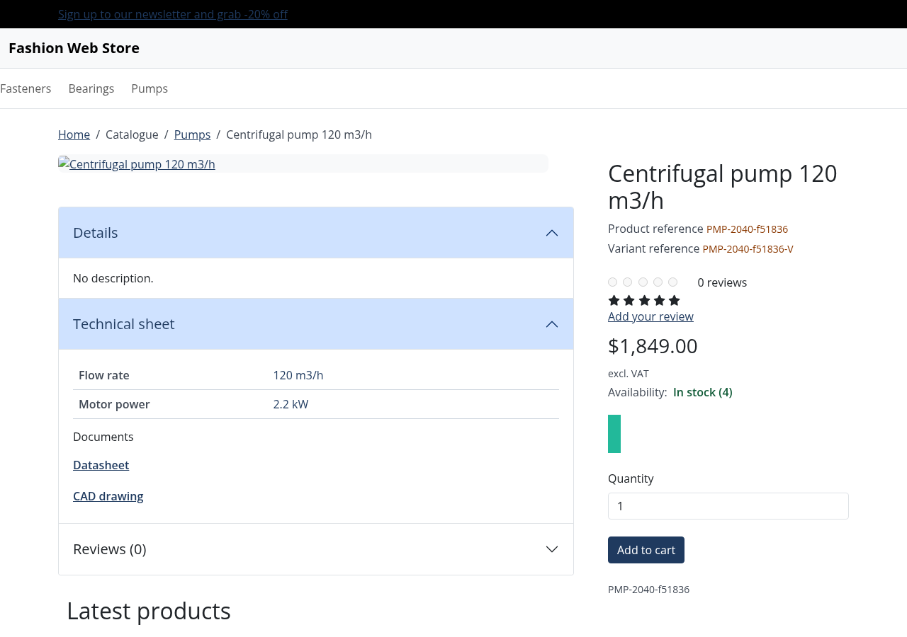
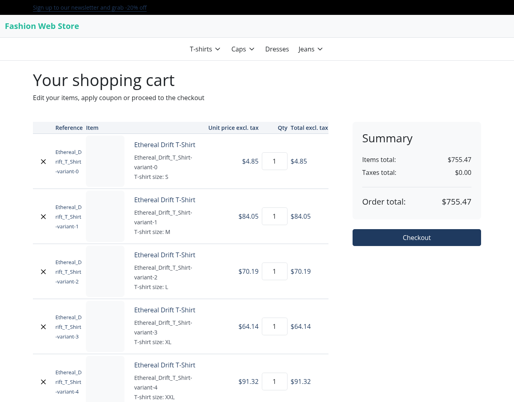
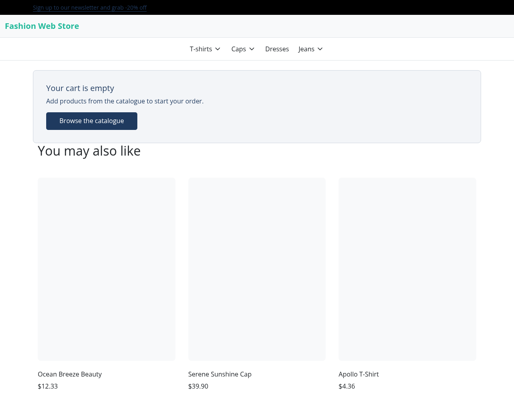
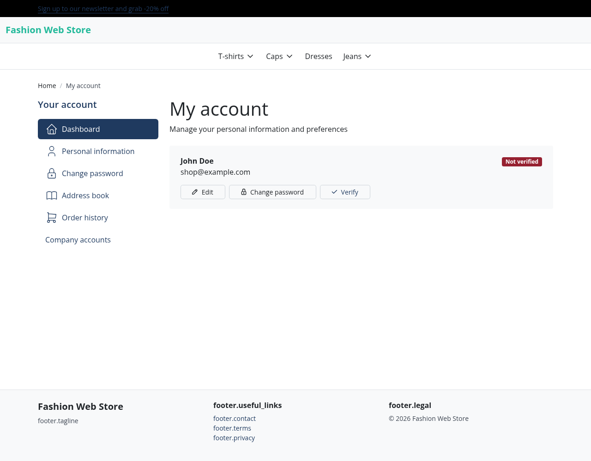
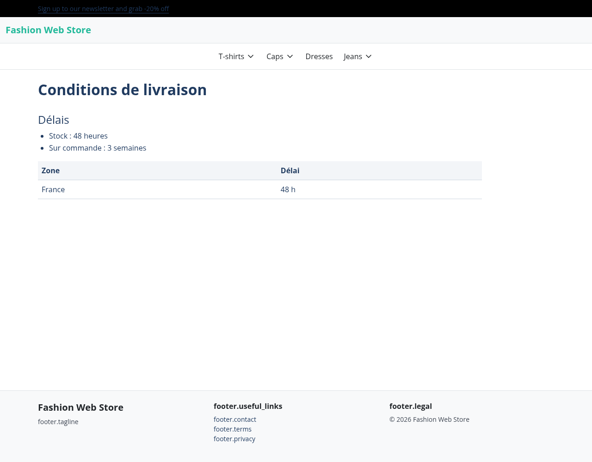

# Sylius Industry & Trade Theme

> Français : [README.fr.md](README.fr.md) <!-- vitrine:lang -->

B2B theme for [Sylius](https://sylius.com) 2 optimized for industry and trade: high information density, AAA contrasts.

## Features

- **Design tokens**: color palette with WCAG AAA contrasts (≥ 7:1), overridable via CSS custom properties
- **Common components**: header, footer, buttons, tables, forms, messages
- **Cart, account and content pages**: dense cart (reference, editable quantity, prices excl. tax), themed account navigation (plugin entries included only when the plugin is installed), content page layout `@TmonierSyliusIndustryTradeTheme/content/page.html.twig`
- **Compatibility**: Sylius 2.2 and 2.3, PHP 8.3+
- **Assets**: Webpack Encore

## Prerequisites

- PHP 8.3 or higher
- Sylius 2.2.9 or 2.3+
- Sylius Theme Bundle ^2.4

## Installation

```bash
composer require tmonier/sylius-industry-trade-theme
```

Copy the configuration to your application:

```bash
cp vendor/tmonier/sylius-industry-trade-theme/config/packages/tmonier_sylius_industry_trade_theme.yaml config/packages/
cp -r vendor/tmonier/sylius-industry-trade-theme/config/twig_hooks config/
```

What the configuration does, and what it never does:

- It registers the Twig namespace `@TmonierSyliusIndustryTradeTheme` (`twig.paths`), resolved on every channel, for the templates the theme adds: the cart "Reference" column, the account navigation items and the content page layout.
- It adds two hookables, `industry_reference`, to the cart head and body (priority 350). They render nothing unless the theme is active on the current channel.
- It does **not** replace any hookable of Sylius or of your application. The themed pages (header, footer, flash messages, cart, account, product list, search field) are template overrides under `templates/bundles/SyliusShopBundle/`, which Sylius applies only to channels using the theme. The hookables you added to `sylius_shop.base.header.content`, `sylius_shop.base.footer.content` or the product list keep rendering, and your own settings on the cart hookables `items`, `coupon`, `summary`, `form` and `account` (template, props, condition, priority) stay yours, on themed and non-themed channels alike.
- The quick order link of an empty cart appears only when the quick-order plugin is installed.

### Install the styles and assets

The package ships SCSS sources, not compiled assets. Import them in the Encore entry of your application, **after** the Sylius shop styles (Sass loader enabled, as in a standard Sylius application):

```scss
// assets/shop/entrypoint.scss (or the stylesheet imported by your shop entry)
@use '../../vendor/tmonier/sylius-industry-trade-theme/assets/styles/theme';
```

then build as usual (`npm run build`). All the rules of the theme are scoped to `[data-theme="industry-trade"]`, an attribute the theme layout sets on `<body>`: on a channel without the theme, or elsewhere in your application, no token and no component changes.

### Theme activation

Sylius must find the theme: its filesystem source scans the directories of `sylius_theme.sources.filesystem.directories` (`composer.json` files, `scan_depth` levels deep), for example

```yaml
sylius_theme:
    sources:
        filesystem:
            scan_depth: 1
            directories:
                - '%kernel.project_dir%/themes'
                - '%kernel.project_dir%/vendor/tmonier'
```

Then set the `theme_name` of a Sylius channel to `tmonier/sylius-industry-trade-theme`.

## Usage

### Customize design tokens

The theme defines its CSS custom properties on `[data-theme="industry-trade"]` (colors, spacing, fonts), not on `:root`, so they cannot collide with the variables of your application. To override them, use the same selector, loaded after the theme stylesheet:

```css
[data-theme="industry-trade"] {
    --bs-primary: #your-navy;
    --industry-accent: #your-accent;
    --bs-link-color: #your-link-color;
    --bs-link-hover-color: #your-hover-color;
}
```

See `assets/styles/theme.scss` for the complete list of available custom properties.

### Override components

On a channel that uses the theme, a template of the theme **wins over** the same template in `templates/bundles/` of your application. The lookup order, for a themed channel, is:

1. the active theme, then its parent themes (`parents` in the theme configuration): `vendor/tmonier/sylius-industry-trade-theme/templates/bundles/<Bundle>/...`;
2. your application: `templates/bundles/<Bundle>/...`;
3. the Sylius bundle: `vendor/sylius/sylius/src/Sylius/Bundle/ShopBundle/templates/...`.

(This is how `sylius/theme-bundle` resolves a template: `NamespacedTemplateLocator` looks in the theme first, `ThemeHierarchyProvider` adds the parents.) A channel without the theme only sees levels 2 and 3.

To change a template the theme overrides, do not copy it into `templates/bundles/`: it would be ignored on themed channels. Create a theme of your own that declares this one as its parent, put your template in it, and set the channel to your theme:

```json
{
    "name": "acme/shop-theme",
    "extra": {
        "sylius-theme": {
            "title": "Acme",
            "parents": ["tmonier/sylius-industry-trade-theme"]
        }
    }
}
```

with `templates/bundles/SyliusShopBundle/...` next to that `composer.json` (in the `themes/` directory of your application by default). The two hookables of the "Reference" column compare the channel theme with `industry_theme_name`: if you use a child theme, redefine that Twig global to the name of your theme (`twig.globals.industry_theme_name`).

Hookables and their props stay the way to change what the theme does not override: add or configure them in your own `sylius_twig_hooks` file.

### Reviewing template drift

Every template the theme overrides under `templates/bundles/<Bundle>/**` is copied from a Sylius template. The unit test `tests/Unit/TemplateDrift/ThemeTemplateDriftTest.php` compares the fingerprint of each original (normalized sha256, per Sylius minor version) with `tests/TemplateDrift/fingerprints.json`, recorded at the last review. It runs in the `unit` testsuite and in a weekly scheduled run (Monday). Overrides are discovered automatically.

When it fails, the message names the template:

- **original template modified**: read the upstream diff between the previously reviewed Sylius version and the new one, adapt the override, then run `php bin/template-fingerprints --update`;
- **template removed upstream**: adapt or remove the override (the script refuses to write while an original is missing);
- **override not registered**: run `php bin/template-fingerprints --update` after review.

The script rewrites the fingerprints of the Sylius minor version installed in `vendor/`. To record the other minor version too, install it (`composer require sylius/sylius:~2.2.0 --no-update && composer update`), run the script again, then restore your constraint. `php bin/template-fingerprints --check` only reports the drift.

## Screenshots

Catalogue pages (rendered with Bootstrap and the theme stylesheet; the shop header and footer are shown without the full Sylius stylesheet).

| Page | Capture |
|------|---------|
| Home (hero, aisles of the channel menu taxon) |  |
| Dense product list (reference, designation, stock, price excl. VAT) |  |
| Product list below 768 px (cards, no horizontal scroll) |  |
| Product page (references, technical sheet, documents, availability) |  |

## Catalogue pages

- **Home**: title, lead text and one link per child of the channel's menu taxon (hidden when the channel has none).
- **Product list**: one row per product with reference, designation, stock, price excl. VAT and an actions cell. The price cell renders the core card hook `sylius_shop.shared.product.card.prices` and the actions cell the hookables of `sylius_shop.shared.product.card` (favourites, add to cart, quote... added by your application or plugins), so a price hidden by your application stays hidden. The exact stock is always shown; below 768 px each row becomes a card. A product without image shows a placeholder.
- **Product page**: product and variant references, availability, technical sheet (product attributes) and a Documents list for attributes whose text value is a link to a pdf, dwg, step, zip, doc or xls file. Blocks from plugins (for example tier pricing) are left to the plugins and simply absent when the plugin is not installed.
- Texts are in the `industry_trade` translation domain (`translations/`, English and French).
- Implemented as theme template overrides (`templates/bundles/SyliusShopBundle/`), which only apply to channels using the theme and leave the hook configuration of your application alone. The only global additions are the two "Reference" hookables, guarded in their templates.

| Cart (12 lines) | Empty cart |
|---|---|
|  |  |

| Account navigation | Content page |
|---|---|
|  |  |

<!-- vitrine:demo-b2b:start -->
## B2B demo

This plugin is used in the [Sylius B2B demo](https://github.com/thibmonier/sylius-b2b-demo): a Sylius 2.3 shop with fictitious sample data where the B2B plugins work together. The source code, setup and fixtures of the demo are in that repository.

- Online demo: [sylius-b2b.thibaut-monier.fr](https://sylius-b2b.thibaut-monier.fr)
- Author: [Thibaut Monier](https://www.linkedin.com/in/thibautmonier/)

The demo is an example, not a production setup.
<!-- vitrine:demo-b2b:end -->

## License

MIT
